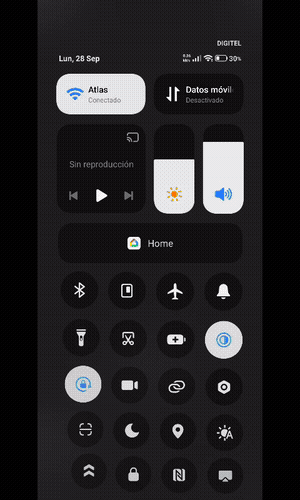
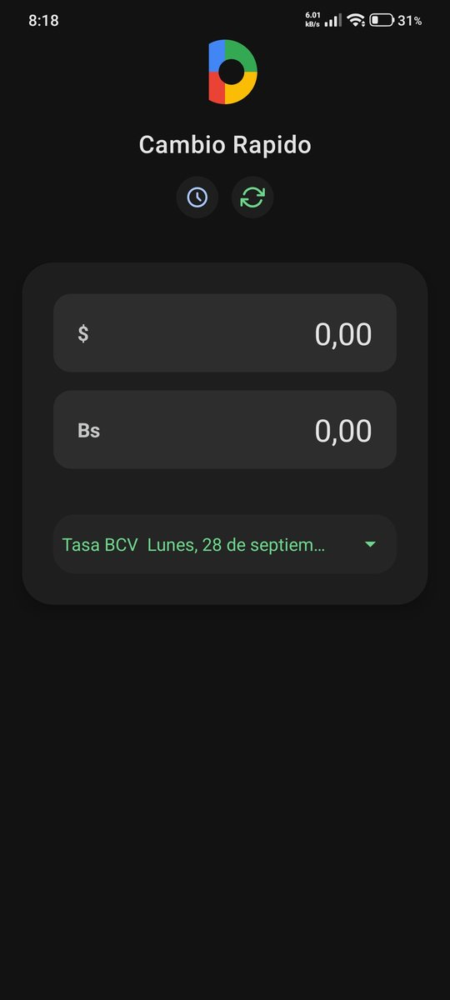
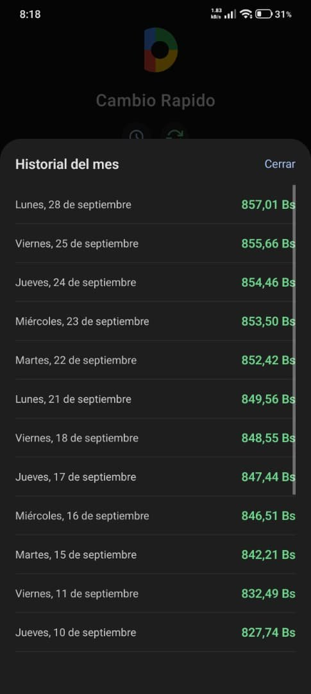
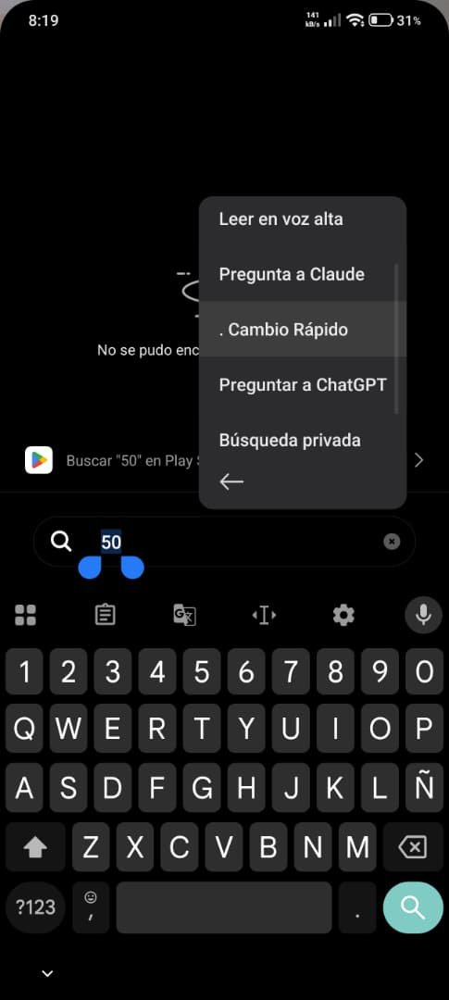
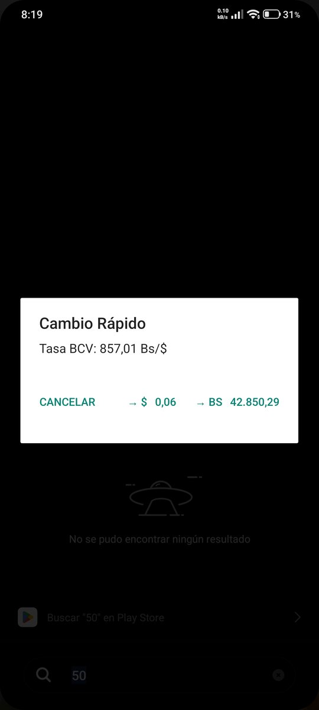
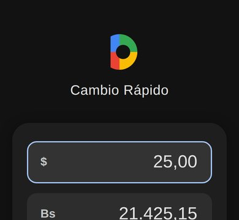

# 💱 Cambio Rápido — Conversor Dólar ⇄ Bolívar

Conversor de divisas pensado para el día a día en Venezuela: toma la **tasa oficial del BCV** desde una API pública y convierte montos al instante, incluso sin conexión (usa la última tasa guardada).

El proyecto tiene dos versiones:

| Carpeta | Tecnología | Qué la hace especial |
|---|---|---|
| [`app-android/`](app-android) | React Native (Expo) + **Kotlin nativo** | Integración profunda con Android: **mosaico en Ajustes rápidos** y conversión desde el **menú de texto seleccionado** de cualquier app. |
| [`pwa-web/`](pwa-web) | HTML + CSS + JavaScript (PWA) | Instalable en iPhone/Android desde el navegador, funciona offline con Service Worker. |


---

## 📸 Capturas

<p align="center">
  
  
  
</p>
<p align="center">
  
  
  
</p>

<p align="center"><sub>Demo del mosaico y del menú contextual · App principal · Historial del mes · Menú "Cambio Rápido" al seleccionar un número · Diálogo de conversión · Versión web (PWA)</sub></p>

---

## ✨ Funcionalidades

- Conversión USD ⇄ Bs en ambos sentidos con entrada tipo "cajero" (los dígitos entran de derecha a izquierda).
- Tasa oficial BCV desde **[DolarApi Venezuela](https://ve.dolarapi.com)** (API pública, sin API key).
- Detecta cuando el BCV publica la tasa del **próximo día hábil**.
- **Historial del mes** con las tasas de cada día; puedes reutilizar una tasa anterior con un toque.
- **Modo sin conexión**: caché local y aviso de la fecha de la última actualización.

### Solo en Android (código nativo en `app-android/plugins/`)

- **`CambioTileService.kt`** — mosaico en el panel de Ajustes rápidos que abre un conversor flotante.
- **`ProcessTextActivity.kt`** — seleccionas un número en *cualquier* app (WhatsApp, navegador…) y aparece "Cambio Rápido" en el menú contextual con la conversión.
- **`app.plugin.js`** — *config plugin* de Expo que inyecta las actividades y el servicio en el `AndroidManifest` y copia el código Kotlin durante el *prebuild*.

## 🚀 Cómo ejecutarlo

**App Android**
```bash
cd app-android
npm install
npx expo run:android          # o: eas build -p android --profile preview
```

**PWA**
```bash
cd pwa-web
npx serve .                   # cualquier servidor estático sirve
```

## 📦 Generar el APK de la app Android

No necesitas Android Studio: el APK se compila gratis en la nube con **EAS Build** de Expo.

```bash
cd app-android
npm install -g eas-cli        # una sola vez
eas login                     # cuenta gratis en expo.dev
eas build:configure           # solo la primera vez (vincula el proyecto a TU cuenta)
eas build -p android --profile preview
```

Al terminar (10-20 min) EAS muestra un **enlace y un código QR** para descargar el `.apk`; ábrelo en el teléfono e instálalo (permite "orígenes desconocidos").

> Si `eas build` da error de permisos, borra en `app.json` las claves `"owner"` y `"extra.eas.projectId"` (pertenecen a la cuenta del autor) y vuelve a ejecutar `eas build:configure`.

| Opción | Comando | Resultado |
|---|---|---|
| APK para instalar directo | `eas build -p android --profile preview` | `.apk` |
| Publicar en Google Play | `eas build -p android --profile production` | `.aab` |
| Compilar en tu PC (requiere Android Studio) | `npx expo run:android --variant release` | `.apk` local |

> La app usa código Kotlin propio (mosaico y menú de texto), así que **no funciona en Expo Go**: hay que instalar el APK.

## 🌐 Publicar la PWA gratis

1. En el repo de GitHub: **Settings → Pages → Deploy from branch → `main`**.
2. La app queda en `https://dominic0285.github.io/cambio-rapido-conversor-divisas/pwa-web/`.
3. En el teléfono ábrela y usa **"Agregar a pantalla de inicio"**: se instala como app y funciona sin conexión.

## 👤 Autor

**Dominic De Freitas** — [GitHub](https://github.com/dominic0285) · [LinkedIn](https://www.linkedin.com/in/dominic-de-freitas-07102828a/)
